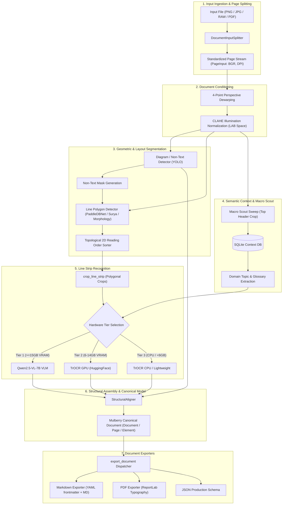

# Mulberry Processing Engine Architecture

This document details the architectural design, component layers, data flows, and hardware execution tiers of the **Mulberry Document Processing Engine** (`processing`).

---

## 1. Overview & System Mission

The Mulberry Processing Engine is an intelligent, hierarchical document digitization system built specifically for complex handwritten notes, diagrams, and multi-page technical documents. It bridges the gap between raw unstructured document captures (smartphone camera photos, RAW digital negatives, multi-page PDFs) and structured, publication-ready outputs ([Markdown](src/exporters/markdown.py), [PDF](src/exporters/pdf.py), and [Canonical JSON](src/canonical/document.py)).

### Core Principles
- **Decoupled 5-Stage Pipeline**: Document conditioning, layout segmentation, dynamic context retrieval, strip recognition, and structural alignment operate independently.
- **Canonical Document as Single Source of Truth**: All pipeline stages output to or manipulate the strongly-typed `Document` model.
- **Hardware-Aware Execution Tiers**: Dynamically adapts models and batch sizes to available GPU VRAM (Tier 1 VLM, Tier 2 TrOCR GPU, Tier 3 Edge CPU).
- **Pluggable Ingestion & Export**: Standardized streaming interfaces for ingestion and modular export dispatchers.

---

## 2. End-to-End Processing Flow

---

## 3. Subsystem Breakdown

### 3.1. Input Ingestion & Page Splitting (`src/input/`)
Ingests heterogeneous media types and converts them into a uniform streaming sequence of canvas images.

- **`DocumentInputSplitter`** (`src/input/splitter.py`): Core orchestrator using a registry pattern. Dispatches input sources to dedicated format handlers.
- **`ImageHandler`** (`src/input/handlers/image.py`): Handles standard raster images (`.png`, `.jpg`, `.jpeg`, `.webp`, `.tiff`, `.bmp`).
- **`RawHandler`** (`src/input/handlers/raw.py`): Integrates `rawpy` / LibRaw to demosaic professional digital camera RAW negatives (`.dng`, `.cr2`, `.nef`, `.arw`).
- **`PdfHandler`** (`src/input/handlers/pdf.py`): Leverages `pypdfium2` (PDFium) to rasterize multi-page PDF documents into individual page canvases at configurable resolution (default 300 DPI).
- **`PageInput`** (`src/input/models.py`): Normalized data transfer object containing the BGR `np.ndarray`, page index, DPI, and media metadata.

### 3.2. Document Conditioning & Preprocessing (`src/extract/preprocessing/`)
Eliminates physical camera distortion and uneven lighting before layout analysis.

- **4-Point Perspective Dewarping** (`src/extract/preprocessing/dewarp.py`): Finds external document contours, detects corner vertices, and executes perspective warp rectification to straighten curved or angled paper shots.
- **Illumination Flattening (CLAHE LAB)** (`src/extract/preprocessing/illumination.py`): Transforms BGR canvases into CIE LAB color space and applies Contrast Limited Adaptive Histogram Equalization to the Lightness channel ($L^*$), eliminating shadows without eroding ink strokes.

### 3.3. Geometric Layout & Line Detection (`src/extract/geometry/`)
Separates non-text graphical elements from handwriting lines.

- **Diagram & Non-Text Segmentation** (`src/extract/geometry/layout.py`): Uses YOLOv8 to locate diagrams, illustrations, flowcharts, formulas, and tables. Produces both bounding boxes and a binary `non_text_mask`.
- **Line Polygon Detectors** (`src/extract/geometry/line_detector.py`):
  - `PaddleDBNetLineDetector`: Uses PP-OCRv3/v4 DBNet to detect arbitrary polygon line envelopes for slanted or curved handwriting.
  - `SuryaLineDetector`: Neural line segmentation fallback.
  - `MorphologyLineDetector`: Lightweight OpenCV morphology fallback (thresholding + anisotropic dilation) for CPU and test execution.
- **Non-Text Mask Filtering**: Masks out non-text regions during line detection to prevent spurious text detections inside diagrams.
- **Topological 2D Reading Order Sorter** (`src/extract/geometry/topological_sort.py`): Sorts line polygons by clustering them into vertical bands and ordering them left-to-right, top-to-bottom.

### 3.4. Semantic Context & Macro Scout (`src/extract/context/`)
Improves handwriting recognition accuracy through domain conditioning.

- **Macro Scout Sweep** (`src/extract/context/scout.py`): Rapidly sweeps the top ~15% of the page canvas to identify title headings and determine the note's subject matter (e.g., "CAP Theorem", "Organic Chemistry").
- **SQLite Context Database** (`src/extract/context/db.py`): Stores user vocabulary, author-specific handwriting corrections, and domain glossaries.
- **Context Retriever** (`src/extract/context/retriever.py`): Supplies topic-specific dictionaries to downstream recognizers.

### 3.5. Line Strip Recognition & Hardware Tiers (`src/extract/recognition/`)
Extracts oriented polygonal line strips via `crop_line_strip` and routes them according to available hardware.

- **Hardware Tier Classification** (`src/extract/config.py`):
  | Tier | VRAM Requirement | Recognizer Backend | Layout / Line Detector |
  | :--- | :--- | :--- | :--- |
  | **Tier 1 (Max Accuracy)** | $\ge$ 15 GB | `QwenVLRecognizer` (Qwen2.5-VL-7B) | YOLO + Surya / PaddleDBNet |
  | **Tier 2 (Balanced)** | 5.5 to 14 GB | `TrOCRRecognizer` (`microsoft/trocr-base-handwritten` on CUDA) | YOLO + PaddleDBNet |
  | **Tier 3 (Edge CPU)** | < 5.5 GB or CPU | `TrOCRRecognizer` (CPU / ONNX) | YOLO CPU + Morphology / Paddle CPU |
- **`crop_line_strip`** (`src/extract/recognition/cropper.py`): Computes minimal bounding rectangles for polygonal line contours, crops with padding, and normalizes orientations.

### 3.6. Structural Assembly & Canonical Model (`src/canonical/`, `src/extract/assembly/`)
Assembles disparate lines and non-text elements into an organized document hierarchy.

- **`StructuralAligner`** (`src/extract/assembly/aligner.py`):
  - Computes median line heights and inter-line spacing.
  - Classifies lines into headings (`# Heading 1`, `## Heading 2`), paragraphs, and bullet points based on scale and layout position.
  - Links captions and diagrams.
- **Canonical Document Schema** (`src/canonical/document.py`):
  - `Document`: Root entity with UUID, title, author, creation timestamp, and metadata.
  - `Page`: Multi-page representation with pixel dimensions and source media tracking.
  - `TextElement`: Typed via `TextKind` (`HEADING`, `PARAGRAPH`, `LIST_ITEM`, `CODE_SNIPPET`).
  - `DiagramElement`: Categorized via `DiagramCategory` (`FLOWCHART`, `TABLE`, `SKETCH`, `FORMULA`).

### 3.7. Document Exporters (`src/exporters/`)
Provides extensible output generation from the canonical model.

- **`MarkdownExporter`** (`src/exporters/markdown.py`): Generates GitHub-Flavored Markdown with YAML frontmatter (metadata, generation timestamps, detection counts), headers, lists, and formatted paragraphs.
- **`PDFExporter`** (`src/exporters/pdf.py`): Uses ReportLab to generate print-ready PDF documents featuring typographic hierarchy, page margins, and headers/footers.
- **`export_document`** (`src/exporters/dispatcher.py`): Unified programmatic dispatcher for exporting any `Document` instance.

---

## 4. CLI Interface (`src/cli.py`)

The engine provides a unified CLI invoked via `processing` or `uv run processing`:

| Command | Description | Example |
| :--- | :--- | :--- |
| `extract` | Full end-to-end HCD-HTR extraction to Markdown or PDF | `processing extract note.png --export markdown` |
| `export` | Converts pre-extracted Canonical JSON to Markdown or PDF | `processing export doc.json -f pdf -o out.pdf` |
| `convert` | Converts RAW/DNG and raster images to other formats | `processing convert raw.dng -f png` |
| `ocr` | Low-level line detection and OCR bounding box inspection | `processing ocr note.png --detector paddle` |
| `vlm` | Direct VLM transcription testing | `processing vlm note.png` |
